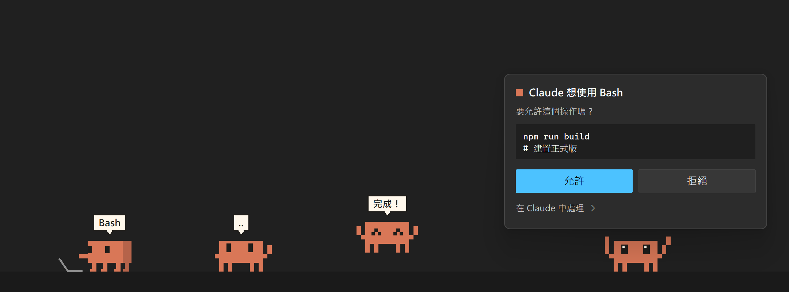

# Clawd 桌寵

一隻會在 Windows 桌面上走來走去的像素 Clawd，會跟著 Claude Code 的工作狀態切換動作。Claude 要你批准權限或回答問題時，可以直接在牠頭上的卡片作答，不用切回 Claude 視窗。

### 👉 [下載最新版](https://github.com/Ji0987/clawd-desktop-pet/releases/latest)

## 安裝

1. 安裝 [Python](https://www.python.org/downloads/windows/) 3.10 以上（預設選項即可，要包含 tcl/tk）
2. 下載 `Clawd-v1.0.0.zip`，解壓縮到固定的位置，例如 `文件\Clawd`
3. 雙擊資料夾裡的 `Clawd.pyw`
4. 第一次執行時，Clawd 頭上會問「要跟 Claude Code 連動嗎？」，按「連動」

連動之後，每次開新的 Claude Code 對話，Clawd 都會自動出現。

> 從 Microsoft Store 安裝的 Python 不會自動開啟 `.pyw` 檔，請在該資料夾開終端機執行 `pythonw Clawd.pyw`。
>
> Clawd 只用 Python 標準函式庫，不需要另外安裝套件；以原始碼發佈，所以「智慧型應用程式控制」不會擋。

## 牠會做什麼

| Claude 的狀態 | Clawd 的反應 |
|---|---|
| 閒置 | 沿著工作列散步、眨眼，兩分鐘沒事就睡覺 |
| 在思考 | 跑到 Claude 視窗旁邊，手扶著頭 |
| 在執行工具 | 敲鍵盤，頭上顯示工具名稱 |
| 需要你批准或回答 | 揮手，頭上出現卡片 |
| 回覆完成 | 開心地跳幾下 |

- Claude 視窗沒有最大化時，Clawd 會跳到視窗上緣坐著
- **點一下**會跳；**拖曳**可以把牠甩出去
- **右鍵選單**：睡覺／起床、開啟 Claude、連動或解除連動、結束

## 在 Clawd 上批准權限、回答問題

只在 **Claude 桌面版**、而且你**不在 Claude 視窗**時才會出現卡片：

- **權限請求**：顯示要執行的指令或檔案，按「允許」或「拒絕」
- **Claude 的提問**：直接點選答案；要自己打字回答就點「在 Claude 中回答」

卡片等待中只要切回 Claude 視窗，就會改用 Claude 原本的對話框，兩邊不會打架。

## 連動做了什麼

連動會在 `%USERPROFILE%\.claude\settings.json` 的 `hooks` 加入以 `pythonw.exe Clawd.pyw hook` 執行的項目，你原本的設定和其他 hook 都不會被動到。Clawd 的狀態檔放在 `%USERPROFILE%\.clawd\`。

搬移 Clawd 資料夾或換了 Python 之後，重新開啟 `Clawd.pyw`，連動的路徑會自動更新。

## 移除

1. 在 Clawd 上按右鍵 →「解除 Claude Code 連動」→「結束 Clawd」
2. 刪除 Clawd 資料夾和 `%USERPROFILE%\.clawd\`

## 開發

直接改資料夾裡的 `.py` 檔，結束 Clawd 再重新開啟即可。各檔案的分工：

| 檔案 | 內容 |
|---|---|
| `Clawd.pyw` | 進入點：不帶參數啟動桌寵，帶 `hook` 參數處理 Claude Code 的 hook |
| `clawd_pet.py` | 桌寵本體：行為、物理、繪製 |
| `clawd_hook.py` | hook：寫入狀態，並把權限請求與提問轉給桌寵 |
| `fluent_ui.py` | Windows 11 風格的右鍵選單與卡片 |
| `clawd_setup.py` | 在 `settings.json` 加入／移除 hook |
| `clawd_ipc.py` | 共用的檔案位置與視窗查詢 |

## 系統需求

- Windows 10／11
- Python 3.10 以上（含 tkinter）
- [Claude Code](https://claude.com/claude-code)（桌面版或終端機版都能連動；在 Clawd 上作答只支援桌面版）

---

本程式為個人非官方創作，與 Anthropic 無關。
